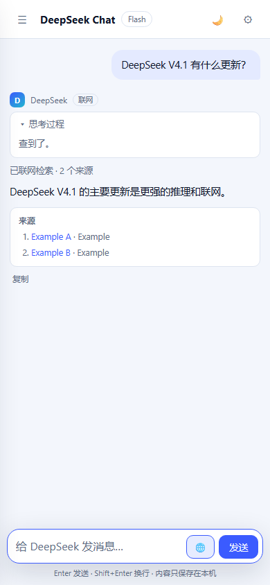

# DeepSeek Chat（网页 / PWA）

一个不用安装、不用后端、数据只留在本机的 DeepSeek API 聊天客户端。填自己的 API Key，直接和 `api.deepseek.com` 通信，绕开官方 C 端的额度限制，按 token 付费。



- 纯静态：HTML + CSS + 原生 JS，零依赖、零构建
- 流式输出、思考过程折叠、Markdown / 代码块复制
- **联网搜索**：一键开关，搜索/抓取都在 DeepSeek 服务端完成，回答带来源列表
- 多会话，本地 IndexedDB 保存；Key 只存 `localStorage`
- 手机浏览器可用，可「添加到主屏幕」当 App 用
- 深色 / 浅色主题、移动端抽屉布局、安全区适配

> 没有服务器，没有账号体系，没有第三方脚本。Key 除了发给 DeepSeek 官方接口，不会去任何地方。

## 本地运行

需要 Python 3（或任意静态文件服务器）：

```bash
cd deepseek-chat
python -m http.server 8787
```

打开 <http://localhost:8787/>。

`localhost` 属于安全上下文，Service Worker 也能正常工作，所以本地就能完整测试 PWA。

## 部署到 GitHub Pages

1. 在 GitHub 新建一个空仓库（public / private 都可以，Pages 对免费账号要求 public）。
2. 在本目录执行：

```bash
git init
git add .
git commit -m "DeepSeek web chat"
git branch -M main
git remote add origin https://github.com/<你的用户名>/<仓库名>.git
git push -u origin main
```

3. 仓库 **Settings → Pages**：
   - Source 选 **Deploy from a branch**
   - Branch 选 **main**，目录选 **/(root)**
   - Save
4. 等一两分钟，访问 `https://<你的用户名>.github.io/<仓库名>/`。

之后每次改动推送 `main` 即可自动更新。Service Worker 是网络优先，刷新一次就会拿到新版本。

## 首次使用

1. 到 <https://platform.deepseek.com> 创建 API Key，并确认账户有余额。
2. 打开网页 → 右上角 **⚙ 设置** → 粘贴 Key → **测试连接 / 查余额**。
3. 选择模型（默认 `deepseek-flash`），按需开关「思考模式」。
4. 保存后回到聊天页开始对话。

手机上：用 Chrome / Edge 打开部署后的 HTTPS 地址 → 菜单 → **添加到主屏幕 / 安装应用**。

## 联网搜索

输入框右侧的 🌐 按钮控制联网，状态会记住，下一条消息继续生效。

- 只支持 **`deepseek-flash`**：从 Pro 切到联网会自动换成 Flash；在设置里选 Pro 会自动关闭联网。
- 打开后声明两个服务端工具：`deepseek_web_search`（搜索）和 `deepseek_read_url`（读取用户消息里的链接）。**搜索和抓取由 DeepSeek 服务端执行，浏览器不直接访问网页。**
- 思考模式开着时是「深度思考搜索」（多步搜索、打开网页、页内查找）；关掉思考则是快速搜索。
- 回答下方会显示「已联网检索 · N 个来源」和来源链接；多轮对话会把 `server_tool_calls` 原样回传，保留阅读过的网页上下文。
- 搜索按次计费：每 1,000 次成功搜索 5 元；一次调用包含几个查询词就按几次算。日常问几句基本是分币级。

## 安全与隐私

- API Key 保存在浏览器 `localStorage`，只随请求发给 `https://api.deepseek.com`。
- 没有后端，没有日志上报，没有第三方字体或脚本；CSP 限制脚本只能来自本站。
- 会话历史保存在浏览器 IndexedDB。清除浏览器数据或在设置里点「清除本机数据」即可删除。
- 页面代码是公开的，但 Key 不在代码里；别人打开你的页面也只能填自己的 Key。
- 不要在公共电脑上保存 Key。Key 泄露后到开放平台吊销重建。

## 费用

按 token 计费，没有 C 端的每日次数限制。以 `deepseek-flash` 为例（2026-11 价格）：高峰输入 ¥2 / 百万 tokens（缓存命中 ¥0.04）、输出 ¥8 / 百万；空闲时段半价。日常聊天通常每月十几到几十元。价格以 [官方页面](https://api-docs.deepseek.com/zh-cn/quick_start/pricing) 为准。

## 已知限制

- 第一版不支持图片输入、语音、云同步、多设备同步。
- 联网搜索只支持 `deepseek-flash`；Pro 模型不支持服务端联网工具。
- 上下文越长越贵；没有自动裁剪，建议长对话适时开新会话。
- 思考模式下 `temperature` 不生效（API 行为）。
- GitHub Pages 在国内偶尔慢；首次加载后由 Service Worker 缓存。
- 浏览器直连依赖 DeepSeek 的 CORS 策略（当前允许任意来源，已实测）；如果将来收紧，需要加一个转发服务。

## 开发

```bash
node --test tests/          # 在普通终端
node tests/sse.test.js      # 或在受限环境里逐个跑
```

生成图标（需要 Pillow）：

```bash
python tools/make-icons.py
```

## 文件结构

```
index.html            页面骨架
styles.css            全部样式
app.js                聊天、存储、设置、流式处理
sse.js                SSE 解析（可单测）
markdown.js           安全 Markdown 渲染（可单测）
websearch.js          联网工具的进度与来源整理（可单测）
sw.js                 离线缓存
manifest.webmanifest  PWA 清单
icons/                应用图标
tests/                单元测试
tools/make-icons.py   图标生成脚本
```

## 协议说明

请求格式为 OpenAI 兼容的 `POST https://api.deepseek.com/chat/completions`：

```json
{
  "model": "deepseek-flash",
  "messages": [{ "role": "user", "content": "你好" }],
  "stream": true,
  "thinking": { "type": "enabled" },
  "reasoning_effort": "high"
}
```

流式响应里，正文在 `delta.content`，思考过程在 `delta.reasoning_content`，以 `data: [DONE]` 结束。
